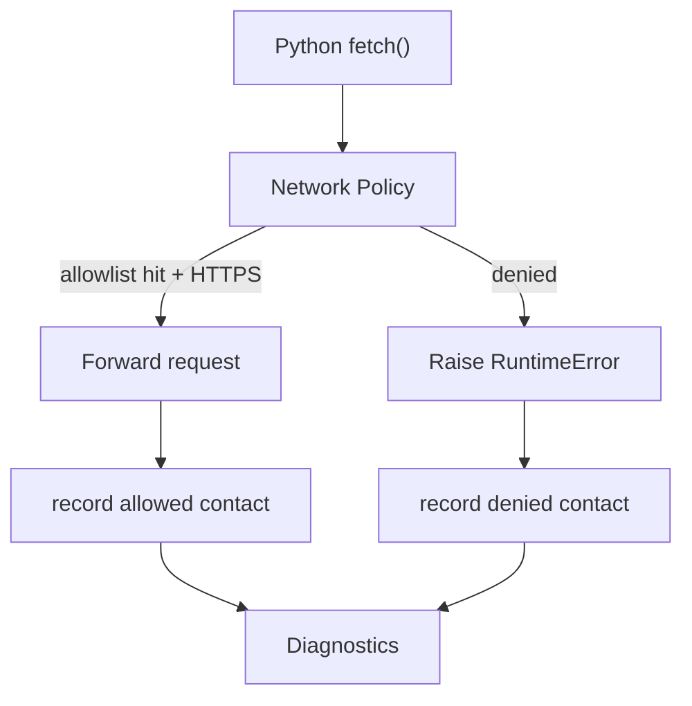
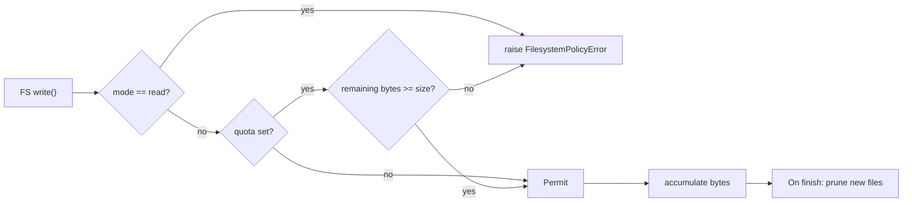
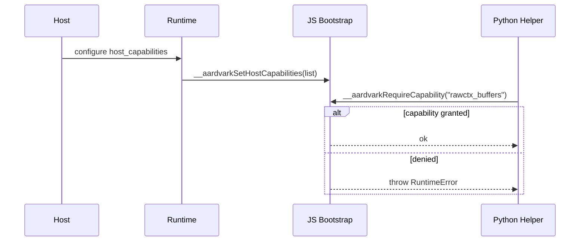

# Sandboxing Model

This document captures how Aardvark limits resource access from Python code.

## Network

- Policies are configured per session via `JsRuntime::set_network_policy`, driven by manifest `resources.network` or host overrides.
- Allowlist entries support exact hosts (`api.example.com`) and wildcard suffixes (`*.example.com`). Optional `:<port>` qualifiers narrow matches.
- HTTPS is mandatory unless the manifest explicitly sets `httpsOnly` to `false`.
- Every outbound fetch records whether it was allowed or blocked. Blocked requests surface with a reason (`no-allowlist`, `scheme-not-allowed`, `host-not-allowed`).
- Denied requests throw into Python as `RuntimeError` with the same reason, so handlers can choose to catch them.

**Limitations**

- Only fetch-style requests are intercepted today. Direct socket access is not exposed, but if [Pyodide](https://pyodide.org/) gains new networking backdoors they still need to be patched into the shim.
- DNS resolution is not measured. Hosts may want to proxy network access when audit-grade logging is required.

## Filesystem

- User bundles mount at `/app`. [Pyodide](https://pyodide.org/)’s standard runtime mounts `/lib`, `/usr`, etc.; these remain read-only.
- The JS shim tracks writes under `/session` via virtual `FS` hooks. Hosts can choose `read` or `readWrite` mode per manifest.
- When writable mode is enabled, an optional quota (bytes written) can be set. Attempting to write beyond the quota raises `FilesystemPolicyError` inside Python.
- On every invocation finish the shim enumerates new/changed files and deletes them to leave the session clean.
- Pyodide's loader fetches distribution files through the native fetch hook (`__pyRunnerNativeFetch`), which guest code can also call. It serves a local file only if the URL's path segments contain no `.`, `..`, `%` or separators and the file canonicalizes to a regular file inside the staged distribution (no traversal, no symlink escapes, no `/proc` or device files). Any other URL goes through the network policy.

**Limitations**

- Quota enforcement is best-effort; it tracks bytes written via the virtual FS layer and does not distinguish truncations versus overwrites.
- Filesystem cleanup is scoped to `/session`. If we ever allow additional writable mounts they must be registered with the shim explicitly.

## Host Capabilities

- Native hooks (RawCtx buffer bridge, future host APIs) are guarded by string capabilities.
- `PyRuntimeConfig.host_capabilities` defines the default allowlist. Manifests may request extra capabilities via `resources.hostCapabilities`; host integrations may further filter the list before calling `apply_host_capabilities`.
- The JS bootstrap exposes `__aardvarkRequireCapability(name)` which throws if the capability was not granted. Python glue calls this before touching native hooks.

**Limitations**

- Only the `rawctx_buffers` capability exists today. Additional host APIs must come with their own capability names and enforcement using the same mechanism.
- Capability denial currently surfaces as `RuntimeError`. Hosts needing structured errors can wrap the invocation result and inspect diagnostics.

## Memory

- `InvocationLimits::heap_mb` caps the context's WebAssembly memory for the call. For Python that is Pyodide's heap: every growth goes through `WebAssembly.Memory.prototype.grow`, which Aardvark replaces at context creation (`js/memory_guard.js`) with a check against the cap. A refused grow makes `malloc` fail, so Python raises `MemoryError`. The call then fails with `FailureKind::HeapLimitExceeded`, even if the handler caught the error.
- The wrappers for `WebAssembly.Memory` and its `grow` are non-writable and non-configurable, and they call only intrinsics captured before guest code runs. The native check is passed into the guard's closure and never published on the global object, so a guest that reaches JavaScript (`import js`) cannot switch the cap off.
- A guest cannot create a new `WebAssembly.Memory` that would push the context past the cap either. After every call, the runtime also adds up the tracked memories and fails the call if the total exceeds the cap (`Diagnostics::wasm_memory_kib` reports it).
- Memories exported by modules instantiated through `WebAssembly.Instance` or `WebAssembly.instantiate` are tracked too, so growth by the `memory.grow` instruction counts in that after-call total.
- `ArrayBuffer` backing stores, which live outside both the V8 heap and WebAssembly memory, come from a counting allocator per isolate. During a call, live ArrayBuffer bytes may grow by at most `heap_mb` beyond their level at the start of the call; an allocation past that fails (`RangeError` in JS) and fails the call with `HeapLimitExceeded`.
- V8 runs with `--wasm-max-mem-pages=65536`, so no WebAssembly memory, memory64 included, can exceed 4 GiB.
- Captured stdout and stderr are capped at 1 MiB each per call, ending in an `[aardvark: output truncated]` marker. Console text from guests is logged at `debug`, not `info`.
- `PyRuntimeConfig::js_heap_limit_mb` caps the JS heap. Nearing it terminates the running call (`HeapLimitExceeded`) instead of letting V8 abort the process.
- `heap_mb` keeps its earlier meaning as well: the JS heap is compared with it before and after the call.

**Limitations**

- Memory never shrinks. A call that grew the heap leaves it grown, and later calls run within the same total. Hosts that need a fresh baseline should recycle the isolate after a `HeapLimitExceeded`.
- A guest-compiled WebAssembly module whose memory it declares itself and does not export is not tracked. Each such memory is bounded by the 4 GiB page cap, but a guest can instantiate several. Separately, growth of a tracked memory through the `memory.grow` instruction is only caught after the call. Run untrusted workloads under an OS-level memory limit as the backstop. Restricting compilation to modules from the staged distribution would close this.
- The per-call amounts add up: WebAssembly memory, ArrayBuffers and the JS heap each have their own cap.

## CPU and Wall Watchdogs

- Wall-clock limits rely on the JS engine’s interrupt mechanism. Once triggered, the Python handler receives a `RuntimeError` and execution stops.
- CPU budgeting is handled in Rust using per-thread CPU timers. The runtime aborts post-execution if the measured CPU milliseconds exceed the limit.
- The work after the call (diagnostics, shared-buffer release, module cleanup) can reach guest-defined JS, such as a published object's `destroy`. It runs under its own 2 s watchdog with the memory cap still in place. Missing that deadline terminates the cleanup and returns `PyRunnerError::TimeoutExceeded { requested_ms: 2000 }`. The runtime's state is then unknown, so recycle it; `BundlePool` keeps the isolate on an error.

**Limitations**

- CPU timers are not available on all targets. When the platform does not supply `thread_cpu_time_ns`, CPU limits can’t be enforced.
- There is no sampling profiler integration yet; only aggregate CPU milliseconds are reported.

## Isolation Gaps & Follow-ups

- **Single-process boundary** – isolation depends on the host process.
- **Network visibility** – DNS, connection metadata, and request bodies are not surfaced today. Follow-up: integrate a host-side proxy and attach explicit telemetry events for those fields.
- **Filesystem visibility** – quota enforcement covers byte counts only. We do not surface the list of mutated files; hosts should mount `/session` onto ephemeral storage until we add exposure.
- **Crash containment** – a fatal trap forces isolate recreation but keeps the process alive. We still rely on host supervision to restart the process.
- **Capability growth** – all native bridges must opt into the capability gate. Audit new host APIs for accidental exposure.
